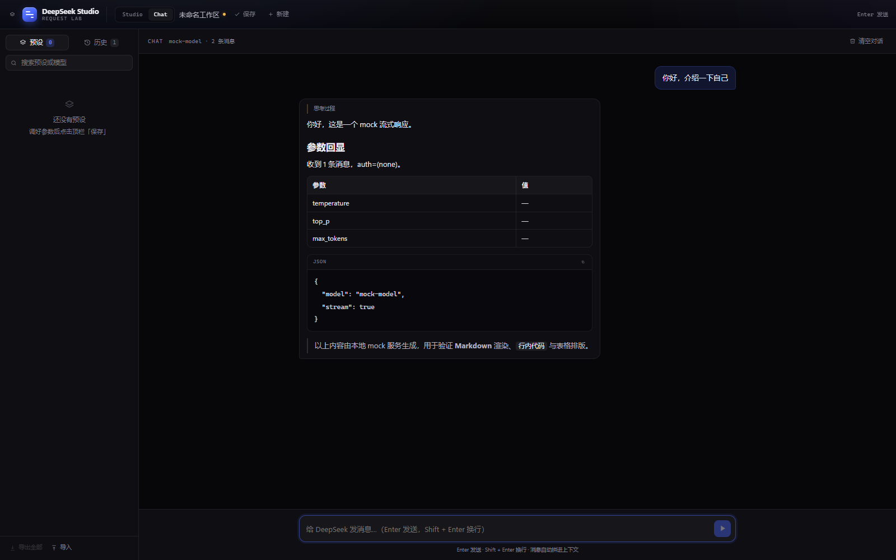
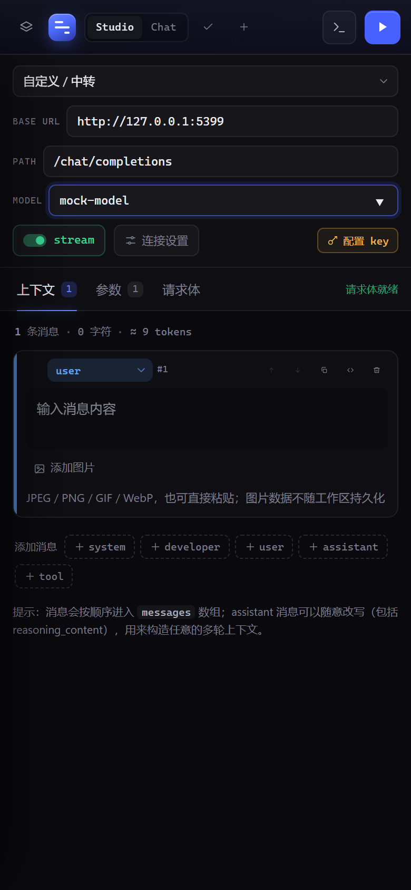
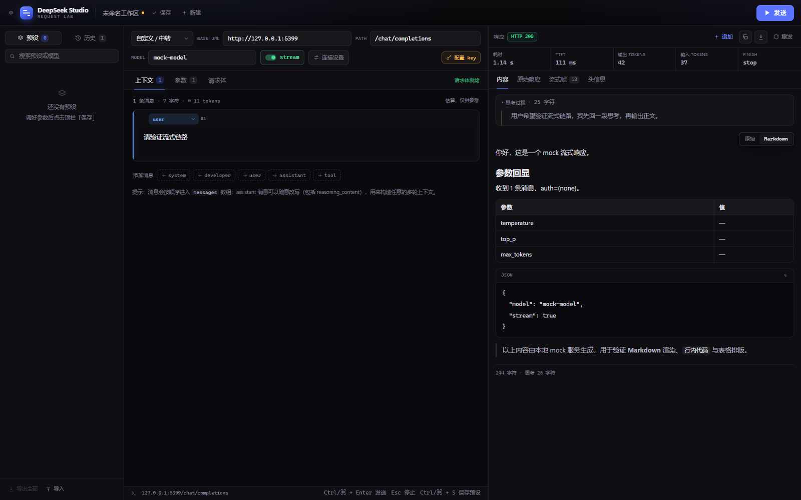

# DeepSeek Studio

> 把一次 Chat Completions 请求拆到每个字段的本地调试台。不是聊天客户端。

聊天界面会替你做很多决定：system 放哪、历史怎么截断、参数用哪个默认值。这个工具相反——请求体里的每一个字段都由你显式决定，包括"AI 发给你的内容"（assistant 历史），并且能看到服务端真正收到的 JSON 和它返回的每个流式帧。

## 快速开始

```bash
pnpm install
pnpm dev
# → http://127.0.0.1:5300
```

首次使用需要提供一个 key，两种方式任选：

1. 编辑项目里的 `.env`：`LLM_API_KEY=sk-...`。Vite 会自动重启，刷新页面后右上角显示 `env key`。
2. 启动后点右上角「连接设置」直接填。只保存在本机浏览器 localStorage，不写入预设、也不会被导出。

方式一的 key 只存在于服务端进程，前端拿不到；方式二由前端随请求发给本地代理。

生产预览同样带代理：

```bash
pnpm build && pnpm preview
# → http://127.0.0.1:4173
```

## 两种模式

顶栏可以在 **Studio** 和 **Chat** 之间切换，两者共用同一份 `messages`：

- **Studio**：精细构造——参数、上下文逐条编辑、原始请求体、流式帧观测
- **Chat**：像普通聊天 AI——输入框发消息，自动把整段上下文拼进 `messages`，回复自动追加为 assistant
- 切换时内容一致：Chat 里聊出来的上下文，切到 Studio 能看到完整 messages、参数和请求体；反过来也一样

Chat 模式细节：Enter 发送、Shift + Enter 换行；system 提示词折叠在顶部，不占对话气泡；`reasoning_content` 收在回复内；「清空对话」只清 messages，不动端点和参数。



## 移动端



- ≤900px 自动变单列：侧栏改成左侧抽屉（顶栏第一个按钮打开，点遮罩或选中条目后关闭）
- Studio 的「编辑 / 响应」用顶栏右侧的图标按钮切换，小屏一次只看一个
- 连接条每行一个字段；消息操作按钮在触屏上常显；状态栏隐藏
- Chat 输入框字号 16px，避免 iOS 聚焦时页面缩放
- 底部输入区适配 `safe-area-inset-bottom`

## 界面



```
┌──────────┬────────────────────────────────┬──────────────────────┐
│ 预设/历史 │ 连接条：baseURL / path / model  │ 响应                  │
│          ├────────────────────────────────┤ 状态 · 耗时 · TTFT ·  │
│          │ 上下文 │ 参数 │ 请求体           │ tokens · finish      │
│          │                                │ 内容/原始/流式帧/头   │
└──────────┴────────────────────────────────┴──────────────────────┘
```

### 上下文

- 任意角色（system / developer / user / assistant / tool）增删、拖拽排序、复制
- 直接改写 assistant 历史消息——包括 `reasoning_content`
- 每条消息可切成完整 JSON 编辑，用于 `content` 数组（多模态）、`tool_calls` 等结构
- **user 消息支持图片**：点「添加图片」或直接粘贴，自动转成 `image_url` 内容块
- 响应面板的「追加到上下文」把回复变成可编辑的 assistant 消息
- 顶部估算字符数与 token（估算值，仅供参考）

## 图片输入（Vision）

`deepseek-flash` 支持图片。在 user 消息里添加或粘贴后，Studio 会把 `content` 自动组装成：

```json
{
  "role": "user",
  "content": [
    { "type": "text", "text": "这张图里有什么？" },
    { "type": "image_url", "image_url": { "url": "data:image/png;base64,..." } }
  ]
}
```

- 支持 JPEG / PNG / GIF / WebP，单图上限 20MB（官方限制：单图 32MB、请求体 48MB、每请求最多 600 张）
- 图片只对 `user` 消息有效；放进 system / assistant 会被忽略并给出提示
- 图片以 base64 内联，**不写入 localStorage**：刷新后只保留占位，需要重新添加
- 也可以用外部 `http(s)` 链接，或 Files API 的 `file_id`（在请求体 RAW 模式里手写）

### 参数

按分组覆盖常用字段：采样（temperature / top_p / top_k / n）、惩罚、长度与停止（max_tokens / max_completion_tokens / stop / seed）、输出格式（response_format / json_schema / logprobs / stream_options.include_usage）、工具调用、高级（reasoning_effort / thinking / user / service_tier / metadata）。

- 每个字段有三种状态：**不发送 / true / false** 或 **不发送 / 具体值**，点字段右上角的 × 可取消发送
- 「额外参数」是一个 JSON 对象，最后合并进请求体：对象递归合并、数组整体替换，可以覆盖上面任何字段，也可以塞面板里没有的新参数
- 参数缺失导致的非法组合会有提醒（例如同时设置 max_tokens 与 max_completion_tokens）

### 请求体

- 实时展示最终 JSON；一旦手动编辑就进入 **RAW 手写模式**，发送时以你写的为准
- 「拆回表单」会把 RAW JSON 反向拆成 model / messages / 已知参数 / 额外参数，未知字段自动归入「额外参数」
- 一键格式化、复制、生成等价 `curl`（key 用 `$LLM_API_KEY` 占位）

### 响应

- 内容、原始响应、流式帧（含每帧到达时间）、请求/响应头
- 正文顶部有「原始 / Markdown」切换：Markdown 模式解析标题、列表、表格、代码块（带复制按钮）、引用、链接与任务列表，流式输出实时渲染；选择会记住
- 错误响应会拆成「主文案 + type/code + request_id（可复制）」，原始 JSON 收进「原始响应」折叠区
- 耗时、TTFT、输入/输出 tokens、finish_reason
- `reasoning_content` 单独展示；`tool_calls` 拆成卡片
- 流式期间可随时 Esc 停止；完成后可重发、导出、追加到上下文

## 续写（DeepSeek Beta）

两个 Beta 接口都需要把 base URL 换成 `https://api.deepseek.com/beta`，provider 下拉里已经内置对应模板。

### 对话前缀续写（Chat Prefix Completion）

最后一条消息必须是 `assistant` 并带 `prefix: true`，模型会接着这段前缀继续写。

1. provider 选「DeepSeek Beta」
2. 在「上下文」末尾加一条 `assistant` 消息，内容写想让模型接着写的前缀（例如 ` ```python\n `）
3. 展开该消息的「附加字段」，勾选 `prefix`
4. 常配一个 `stop`（例如 ` ``` `）防止模型继续解释

### FIM 补全（Fill In the Middle）

1. provider 选「DeepSeek FIM」，path 会变成 `/completions`
2. 到「请求体」切到 RAW，手写 body：

   ```json
   {
     "model": "deepseek-flash",
     "prompt": "def quick_sort(arr):\n",
     "suffix": "    return arr",
     "max_tokens": 64,
     "stream": true
   }
   ```

3. 顶栏 stream 开关要和 body 里的 `stream` 保持一致——它决定前端按 SSE 还是 JSON 解析
4. 响应取 `choices[].text`，会正常显示在正文区

## DeepSeek 专属约束

默认端点是 DeepSeek 官方接口（当前模型 `deepseek-flash` / `deepseek-v4-pro`），Studio 会按它的实际行为给出提示。这些提示**不会拦截发送**——测试平台需要能把非法请求发出去看服务端怎么回。

- `n` 只接受 `1`：`n > 1` 会返回 `400 Invalid n value`，参数面板会直接标红
- `frequency_penalty` / `presence_penalty` 已废弃，传入不生效
- `response_format` 只支持 `text` / `json_object`，`json_schema` 会被拒绝
- 未显式关闭时思考模式默认开启，此时 `temperature` / `top_p` 不生效；要采样控制需设 `thinking: disabled` 或 `reasoning_effort: none`
- `deepseek-reasoner` 旧模型的多轮上下文不能回传 `reasoning_content`，否则会 400
- 只有 `api.deepseek.com` 会套用这些规则；自定义中转地址按通用行为处理

## 快捷键

| 键 | 动作 |
| --- | --- |
| `Ctrl / ⌘ + Enter` | 发送 |
| `Esc` | 停止流式 |
| `Ctrl / ⌘ + S` | 保存当前工作区到预设 |

## 数据与安全

- 工作区、预设、历史都保存在浏览器 localStorage，刷新不丢
- 历史默认保留最近 40 条，点击可恢复当时的请求与响应
- 预设支持导出/导入 JSON；导出内容不含任何 key
- `Authorization` 由本地代理按 key 注入；代理只转发 `http/https`，不记录 key
- 所有请求经由本地 Node 代理（`/api/proxy`）转发，绕过浏览器 CORS 并保留 SSE

## 网络与代理

转发默认直连。访问 OpenAI 等需要代理的端点时，在 `.env` 里取消注释并填写：

```bash
HTTPS_PROXY=http://127.0.0.1:7890
```

终端里已有的 `HTTPS_PROXY` / `HTTP_PROXY` 环境变量同样生效；`localhost` 和 `127.0.0.1` 会自动绕过代理。修改 `.env` 后 Vite 会自动重启，刷新页面即可看到右上角的 key 状态变化。

## 部署

线上地址：**https://studio.laosibai.com/**（自定义域，GitHub Pages 托管）

- 推送 `main` 自动构建部署（`.github/workflows/deploy.yml`），GitHub Pages 地址是 https://laosibai.github.io/deepseek-studio/
- Cloudflare DNS 中 `studio` 是 CNAME → `laosibai.github.io`（DNS only）
- 仓库 `public/CNAME` 固定自定义域，GitHub Pages 已开启 HTTPS

静态部署没有本地代理，前端会探测 `/api/env`：存在则走代理，不存在则自动切换为**浏览器直连**。DeepSeek 官方接口允许跨域，所以在「连接设置」里填自己的 key 就能直接用。

## 项目结构

```
server/proxy.ts          # Vite 中间件：/api/env、/api/proxy（SSE 透传）
src/lib/params.ts        # 参数 schema、请求体构建、RAW 反向解析
src/lib/deepseek.ts      # 识别官方端点 + DeepSeek 能力约束
src/lib/errors.ts        # 错误响应结构化（message / type / request_id）
src/lib/api.ts           # 发送与 SSE 解析（chat delta / FIM text / usage）
src/components/Markdown.tsx  # 轻量 Markdown 解析与渲染（无第三方依赖）
src/state/studio.tsx     # 工作区 reducer + localStorage 持久化
src/components/          # 三栏 UI
scripts/mock-server.mjs  # 本地 mock SSE 端点（chat / FIM / 400 错误）
scripts/ui-smoke*.mjs    # Playwright 冒烟测试（需本机 Chrome）
```

## 本地验证

```bash
node scripts/mock-server.mjs     # 终端 A，mock 端点 127.0.0.1:5399
pnpm dev                         # 终端 B
node scripts/ui-smoke-2.mjs      # 终端 C：填参 → 发送 → 改写上下文 → 保存 → RAW 拆回
```

## 已知边界

- 只针对 `chat/completions` 形态；embeddings、responses、images 等接口可以靠自定义 path 打过去，但没有专门的渲染
- 上下文是手动编排的，不会自动追加每一轮对话
- token 数是按字符估算的，不是分词器结果
- Markdown 渲染是内置的轻量解析器：不执行 HTML、不做代码语法高亮，链接只放行 `http(s)` / `mailto`
- 依赖浏览器直连本地代理，因此必须通过 `pnpm dev` / `pnpm preview` 打开，不能直接开 `index.html`
